<div align="center">

# 🧠 Neural Networks, Monte Carlo Simulation and Image Recognition
### A Decision Analysis Approach

**Three experiments in decision analysis: from Monte Carlo simulation to a neural network that reads handwritten digits, with the network built from scratch in NumPy.**


*Final project · Methods of Decision Analysis · BIDA (2nd year)*
*Authors: Javier Gonzalo & Mauricio Valdez*

</div>

---

## 📌 The project in one minute

| | Question | Technique | Headline result |
|---|---|---|---|
| **Task 1** 💶 | Which customer-support strategy earns the most money, and how risky is it? | Monte Carlo simulation (100,000 runs) | Outsourcing ≈ **509k €** vs chatbot ≈ **505k €** vs in-house ≈ **425k €** per year |
| **Task 2** 🚢 | Can a small neural network predict who survived the Titanic? | Neural network coded by hand (NumPy) vs a linear model | **78.3 %** vs 72.4 % for the linear baseline |
| **Task 3** ✍️ | Can a network recognise handwritten digits (MNIST)? | Same network, upgraded with Leaky ReLU, mini-batches and a learning-rate schedule | **97.6 %** on 10,000 unseen test images |

The tasks build on each other. Task 1 teaches us to reason under uncertainty. Task 2 builds the neural network engine. Task 3 scales that same engine up from 4 inputs to 784.

> **No machine-learning framework does the learning here.** Forward pass, backpropagation and gradient descent are written with plain NumPy matrix operations, so every step is visible and explainable.

<details>
<summary><b>🗂 Repository layout</b></summary>

```
.
├── notebooks/
│   ├── task1_montecarlo_simulation.ipynb      # Task 1
│   ├── task2_titanic_neural_network.ipynb     # Task 2
│   ├── task3_mnist_main.ipynb                 # Task 3 (full write-up, answers 3a–3d)
│   ├── task3_mnist_test_evaluation.ipynb      # Task 3 (re-run, evaluated on the test set)
│   └── Titanic_Dataset.csv
└── assets/                                    # every figure used in this README
```
</details>

---

# 💶 Task 1 · Monte Carlo simulation: which support strategy wins?

### The problem
A company has to decide how to handle roughly **8,000 customer-support tickets a year**. Three options:

| Strategy | Fixed yearly cost | Variable cost per ticket | Churn (customers lost) |
|---|---|---|---|
| 🔵 **In-house** team | 7,500 € training + 144,000 € staff/phone | ~3.45 € | low (~10 %) |
| 🟢 **Outsource** to a third party | 6,000 € training + 12,000 € platform fees | ~1.31 € | higher (~20 %) |
| 🔴 **Chatbot** | 2,000 € training + 7,680 € maintenance/GPU | ~1.35 € | lowest (~8 %), but the bot only *resolves* ~85 % of tickets |

Almost nothing here is certain: ticket volume, cost per ticket, churn and the chatbot's success rate all fluctuate. A single "expected value" calculation would hide that, so we simulate.

### The method
Every uncertain quantity gets a probability distribution, and the model is run **100,000 times**:

- tickets per year → Normal(8000, 800)
- cost per ticket → Normal (different mean and spread per strategy)
- churn → **Beta** distribution (a natural choice for a rate between 0 and 1)
- chatbot success rate → Beta(8.5, 1.5)

Each run yields the **Expected Monetary Value (EMV)**, the annual profit for that strategy:

```python
revenue = tickets * (1 - churn) * client_profit_per_year      # 7 € × 12 months per client
emv     = revenue - (cost_per_ticket * tickets + fixed_costs)
```

### The results

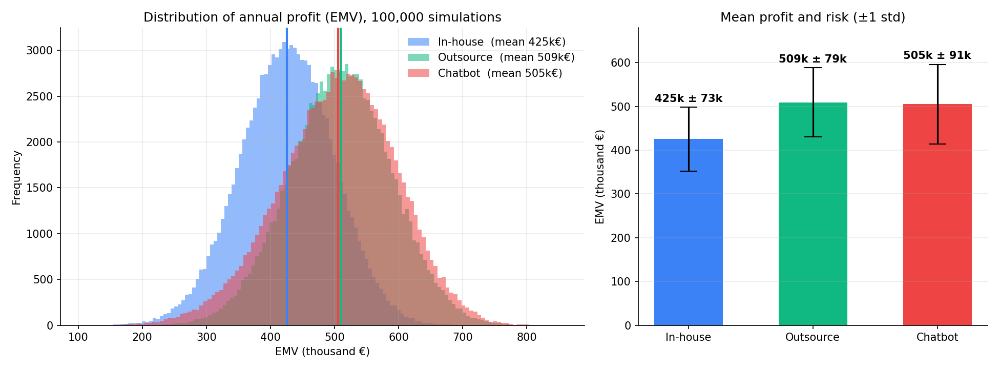

| Strategy | Mean EMV | Std. deviation (risk) |
|---|---|---|
| 🔵 In-house | 425,492 € | 72,678 € |
| 🟢 **Outsource** | **508,750 €** | 79,043 € |
| 🔴 Chatbot | 504,954 € | 91,192 € |

<details>
<summary><b>📊 More plots from the notebook</b></summary>

| Cumulative probability (chance of beating a given profit) | Box plots |
|:---:|:---:|
| 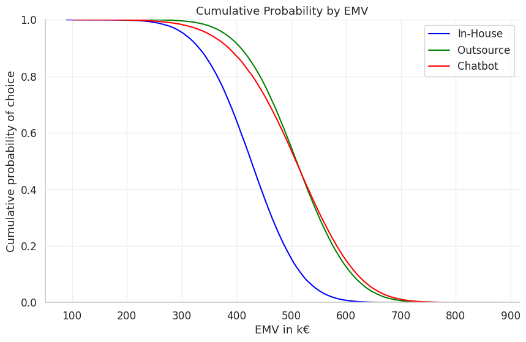 | 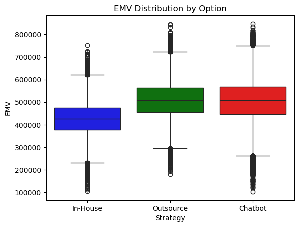 |

| In-house | Outsource | Chatbot |
|:---:|:---:|:---:|
| 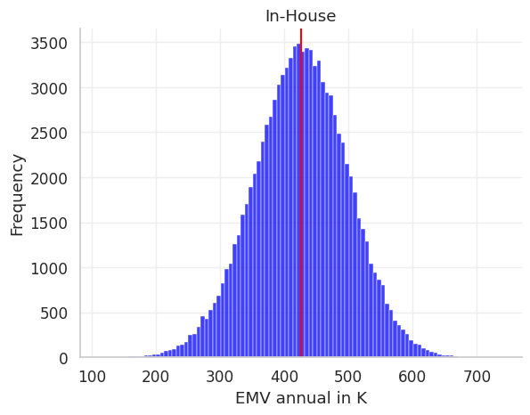 | 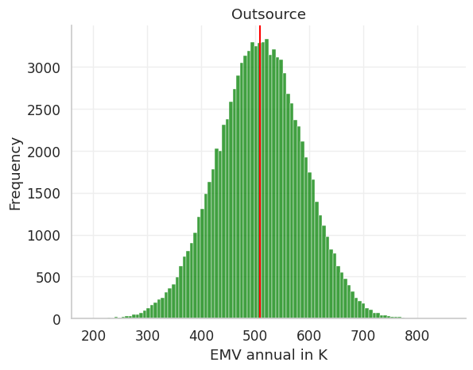 | 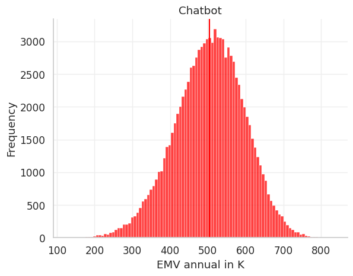 |

</details>

### 💡 What it means
- **In-house is clearly the weakest option.** Its whole curve sits to the left of the other two.
- **Outsource vs chatbot is a risk decision, not a profit decision.** The mean profits are almost identical (about 4k € apart), but the chatbot's spread is ~15 % wider. Outsourcing gives the best value with less risk. The chatbot suits a team with a higher risk tolerance and an optimistic outlook.
- **The chatbot has hidden upside.** If one engineer were kept on a 5k € monthly contract and the other only for yearly training, the chatbot's cost per ticket would drop and its mean profit would overtake outsourcing.

---

# 🚢 Task 2 · A neural network from scratch on the Titanic

### The problem
Given a passenger's **class, sex, age and number of siblings/spouses aboard**, predict whether they **survived**. The dataset has 1,046 usable passengers (rows with missing values are dropped).

### Step 1 · A baseline to beat
A scikit-learn linear model scores **72.4 %**. For reference, always guessing "did not survive" would be right 59.2 % of the time. The network has to beat both.

### Step 2 · The network
A small **[4, 5, 2]** network: 4 inputs → 5 hidden neurons → 2 outputs (died / survived).

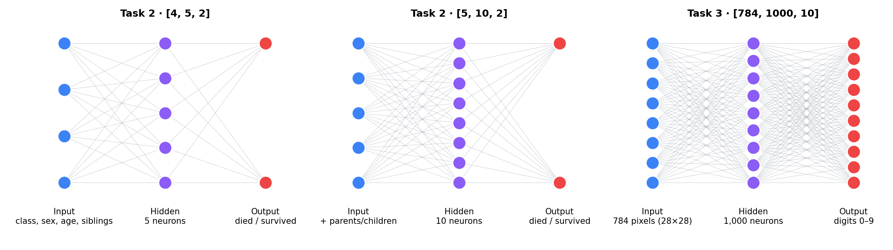

Pieces built by hand, each one a short NumPy function:

| Piece | What it does |
|---|---|
| `normalise` | Converts every feature to z-scores. Without it, *age* (0–80) would drown out *class* (1–3) and the gradients would misbehave. |
| `sigmoid` / `sigmoid_prime` | Squashes values into 0–1 and gives the derivative needed to learn. |
| `forward_pass` | Pushes a passenger through the layers and returns two probabilities. |
| `backpropagation` | Computes how much each weight contributed to the error, working backwards from the output. |
| `evaluate` | Counts correct predictions. |

Weights start random. Passengers are shuffled, then the network is updated one passenger at a time (learning rate 0.1).

### Step 3 · Adding a fifth feature
The task asks for one more input. A correlation heatmap tells us which one adds the least overlap with the others:

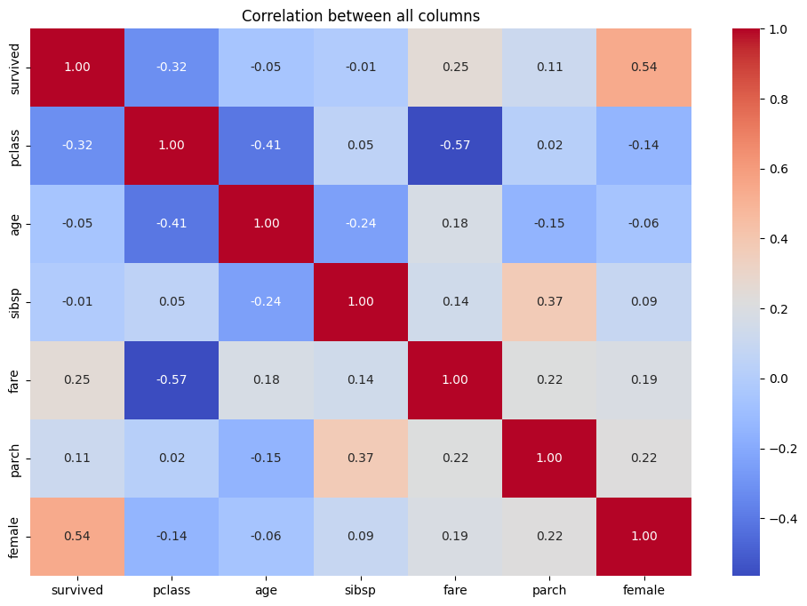

`fare` is tightly tied to `pclass`, which would add redundancy. `parch` (parents/children aboard) is the least entangled, so it was chosen. The hidden layer was grown to 10 neurons after trying every size from 6 to 10, plus 20 and 100.

### Step 4 · Mini-batches
The training loop was then rewritten to use **mini-batches** (15 passengers per step, 50 steps).

### The results

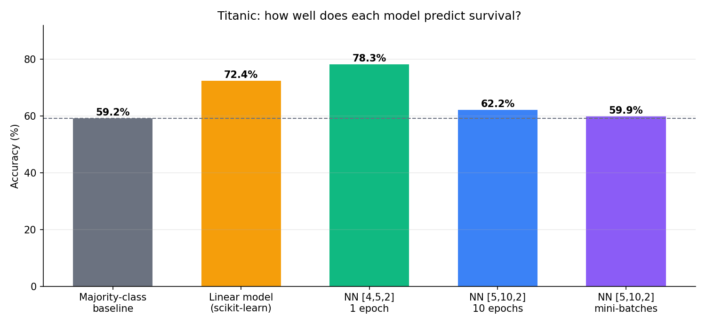

| Model | Accuracy |
|---|---|
| Always guess "died" | 59.2 % |
| Linear model (scikit-learn) | 72.4 % |
| 🏆 **Network [4, 5, 2]** | **78.3 %** |
| Network [5, 10, 2] | 62.2 % |
| Network [5, 10, 2] + mini-batches | ~59.9 % |

### 💡 What it means
- ✅ A tiny network **beats the linear model by about 6 points**, although the margin is smaller than we expected for something so much more complex.
- ❌ **More is not better.** Adding `parch` *lowered* accuracy. The most likely explanation is that the original four features already carry most of the signal, and an extra, weakly informative input only adds noise.
- ❌ Mini-batches with the same learning rate made training unstable. The accuracy curve shows sudden collapses (e.g. 59 % → 42 % → 59 %), pointing to a learning rate that is too high.
- **Why two output nodes?** One per possible outcome. A single sigmoid output can also work, but then it behaves like logistic regression: the sign of the output decides the class.

> ⚠️ **Honest caveat:** the network accuracies are measured on the same passengers it trained on, while the linear baseline uses a train/test split. The comparison is therefore generous to the network, which is exactly why Task 3 introduces a proper held-out test set.

---

# ✍️ Task 3 · Reading handwritten digits (MNIST)

### The problem
Classify **28 × 28 pixel images of handwritten digits (0–9)** from the classic MNIST dataset: 50,000 training images, plus separate validation and test sets.

### Why this architecture?


- **784 inputs** = 28 × 28 pixels. One input neuron per pixel, so the network sees the whole image.
- **10 outputs** = one per digit. The digits have no natural order (a 3 is not "between" a 2 and a 4), so collapsing them into fewer outputs would throw information away.
- **1,000 hidden neurons**, chosen by experiment.

### The four discoveries that made it work

<table>
<tr><td width="60"><h2>🚀</h2></td><td>

**1. GPU training: tried, then dropped.** Matrix maths is exactly what GPUs are good at, so we explored PyTorch on a Mac. But PyTorch uses tensors while our whole codebase uses NumPy arrays; rewriting it was not worth it. (`torch` is still imported in the notebook for reference.)

</td></tr>
<tr><td><h2>⚡</h2></td><td>

**2. ReLU → Leaky ReLU.** Spotted in the PyTorch tutorials. Plain ReLU switches too many neurons off permanently, so we use **Leaky ReLU**, which keeps a small slope (0.01) for negative values. It is cheaper to differentiate than sigmoid and avoids vanishing gradients.

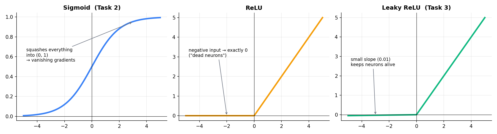

</td></tr>
<tr><td><h2>🎲</h2></td><td>

**3. Mini-batches, found by accident.** While debugging with just 100 images, a bug made the loop keep re-using 100 images. Fixing it by **drawing 100 fresh random images every epoch** turned out to be exactly mini-batch training, and it gave a better, more reliable model.

```python
for epoch in range(200):
    sample_idx = np.random.choice(len(training_inputs), size=100, replace=False)
    for i in sample_idx:                       # 100 new images each epoch
        nabla_b, nabla_w = backpropagation(bias, Weight, num_layers, x, y)
        Weight = [w - eta * nw for w, nw in zip(Weight, nabla_w)]
        bias   = [b - eta * nb for b, nb in zip(bias, nabla_b)]
```

</td></tr>
<tr><td><h2>📉</h2></td><td>

**4. A decaying learning rate + a learning curve.** Big steps first, small steps later. The accuracy-versus-epoch plot doubles as a learning curve and shows diminishing returns: the curve flattens as extra compute buys less and less improvement (a pattern also described in neural scaling-law research).

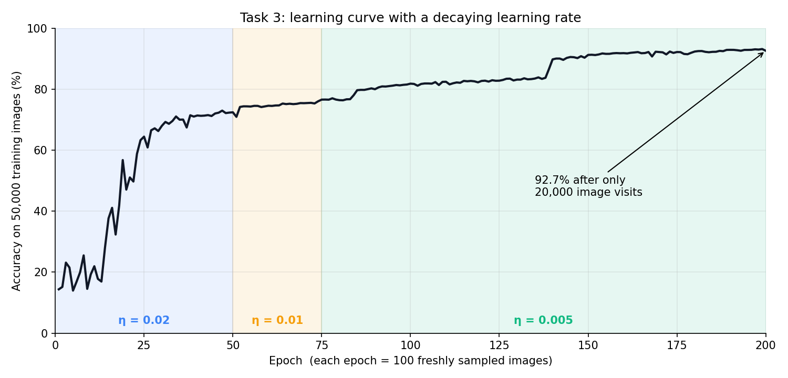

</td></tr>
</table>

Weights are initialised with **He initialisation** (`np.sqrt(2 / n_inputs)`), which suits ReLU-family activations.

### The results

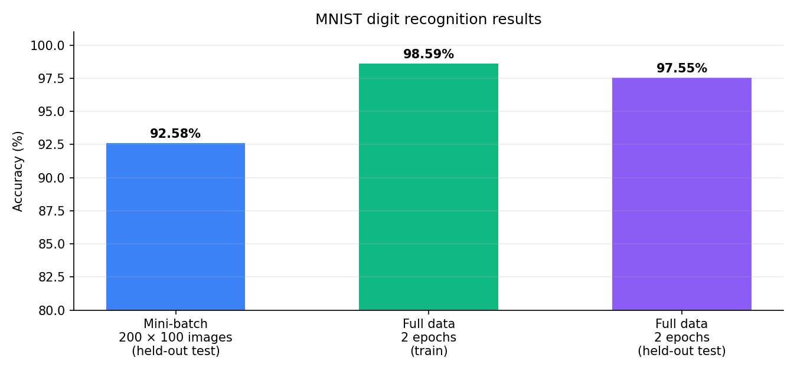

| Setup | Accuracy |
|---|---|
| 200 mini-batch epochs × 100 images (20,000 image visits) | 92.6 % on the **test set** |
| 2 full passes over all 50,000 images | 98.6 % on the training set |
| 2 full passes over all 50,000 images | **97.6 % on the test set** |

### 💡 What it means
- Starting from random guessing (~10 %), the network learns to read digits **with no image-specific tricks**, only pixels and gradient descent.
- **Two full passes** beat 200 small mini-batch epochs, because it has simply seen far more data.
- The gap between training (98.6 %) and test (97.6 %) accuracy is only 1 point, so the model **generalises** rather than memorising.

---

# 🔬 Key takeaways

1. **Simulate, don't guess.** A distribution of outcomes shows risk that a single average hides (Task 1).
2. **A neural network is just matrix multiplication plus the chain rule.** Writing it by hand makes the maths concrete (Tasks 2 and 3).
3. **Bigger is not automatically better.** An extra feature made the Titanic model worse. Task 3 shows where scale did help.
4. **The training details matter as much as the architecture:** normalisation, activation function, initialisation, batch size and learning-rate schedule.
5. **Always evaluate on data the model has not seen.**

---

# ▶️ Run it yourself

```bash
git clone https://github.com/datamauriciovaldez/neural-networks-monte-carlo-simulation-and-image-recognition-a-decision-analysis-approach.git
cd neural-networks-monte-carlo-simulation-and-image-recognition-a-decision-analysis-approach
pip install numpy pandas matplotlib seaborn scikit-learn jupyter torch
jupyter notebook notebooks/
```

> **Data paths:** the notebooks were written to load data from a sibling `../Data/` folder. Either create that folder next to `notebooks/` or edit the path in the loading cell. `Titanic_Dataset.csv` is included. The Task 3 notebooks need the MNIST file `mnist.pkl.gz` (**not included**; it is the standard pickled MNIST from the *Neural Networks and Deep Learning* book).

---

<div align="center">

Made by **Javier Gonzalo** & **Mauricio Valdez** · Methods of Decision Analysis · BIDA

</div>
